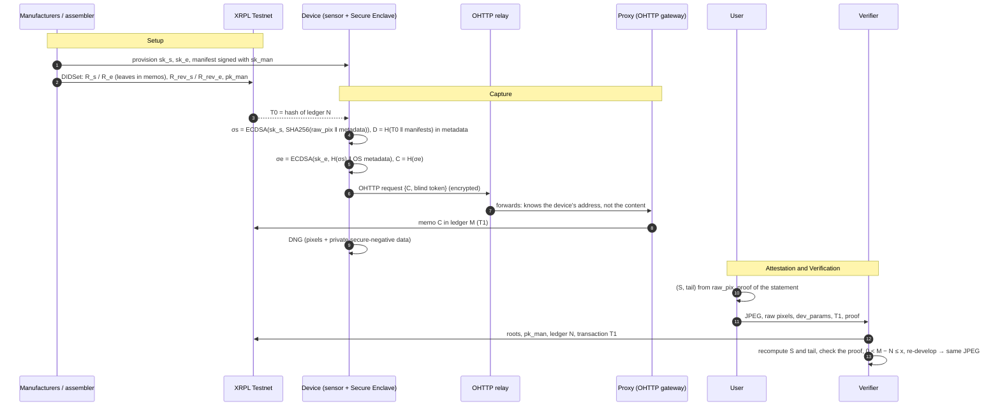

# Architecture

This document describes how the code in `decima/` implements the protocol of the [README](README.md) (Setup, Capture, Attestation, Verification) as a simulation on the **XRPL Testnet**. The README is the specification; this file explains where each part of it lives and how the parts fit together.

## Sectors

The package is split by protocol phase, plus the shared building blocks they depend on.

| Directory | README section | What it does |
|---|---|---|
| [`decima/core/`](decima/core/) | (shared) | Configuration, Testnet wallets, SHA-256 (including resumable), ECDSA P-256, Merkle and indexed Merkle trees, XRPL access |
| [`decima/device/`](decima/device/) | Capture | The camera: raw frame layout, photo sensor (σs), Secure Enclave (σe), test scenes |
| [`decima/setup/`](decima/setup/) | Setup | Factory provisioning, on-chain roots of trust (trust root, key registries, revocation registries, pk_man) |
| [`decima/capture/`](decima/capture/) | Capture | Capture flow, OHTTP, prepaid blind tokens, the proxy that publishes C, DNG files |
| [`decima/attestation/`](decima/attestation/) | Attestation | The statement, the proof system (simulated Longfellow), the package the user sends |
| [`decima/pipeline/`](decima/pipeline/) | Verification | The admitted development pipeline: raw pixels + dev_params → JPEG |
| [`decima/verification/`](decima/verification/) | Verification | Every check the verifier runs |
| [`decima/demo.py`](decima/demo.py) | all | Runs every phase in order, optionally with attacks |

Dependencies only point "down": `core` ← `device` ← `setup`, `capture` ← `attestation`, `pipeline` ← `verification` ← `demo`. No sector imports a phase that comes after it.

## Actors

| Actor | Holds | Simulated by |
|---|---|---|
| Sensor manufacturer | Registry R_s of H(pk_s), revocation registry R_rev_s | XRPL account `sensor_maker` (DID + memos) |
| Secure Enclave manufacturer | Registry R_e of H(pk_e), revocation registry R_rev_e | XRPL account `enclave_maker` |
| Assembler | Manifest key sk_man; publishes pk_man | XRPL account `assembler` + `out/makers/` |
| Trust root (pre-existing, out of scope) | Admitted manufacturers, circuit hashes, pipelines, dev_params | XRPL account `trust_root` |
| Device | sk_s (sensor), sk_e (Secure Enclave), manifests | `out/devices/<id>/` |
| Proxy | Token-signing key, OHTTP gateway key; publishes C | XRPL account `proxy` + `out/proxy/` |
| User | Prepaid blind tokens | XRPL account `user` + `out/user/` |
| Verifier | Nothing secret: reads the package and the ledger | `decima/verification/` |

## Protocol flow



## Data formats

**Raw frame** (`device/frame.py`): `raw_frame = raw_pix ‖ metadata`, streamed in this order and signed by the sensor as `σs = ECDSA(sk_s, SHA256(raw_frame))`.
- `raw_pix`: 12-bit RGGB pixels, little-endian uint16, row-major.
- `metadata`: 59 bytes, fixed layout: magic `IXMD`, then `dev_fields` (width, height, CFA, bit depth, black level, white level), then the private fields (frame counter, exposure, gain) and the 32-byte `digest_slot` holding `H(T0 ‖ dev_manifest ‖ boot_manifest)`.

**S and tail** (`core/sha256.py`): SHA-256 state after the last full 64-byte block of `raw_pix`, and the remaining bytes. The prover and the verifier compute them from the pixels; the circuit only resumes the hash over `tail ‖ metadata`.

**On-chain** (`setup/registry.py`), DID Data (128-byte cap) and memos (1 KB cap):

| Account | DID Data | Memos |
|---|---|---|
| Trust root | `IXT2` ‖ SHA-256 of the trust-root document | the document (JSON) |
| Sensor / enclave maker | `IXR2` ‖ kind ‖ size ‖ R ‖ revoked count ‖ R_rev | added H(pk) leaves; revoked H(pk) |
| Assembler | `IXA2` ‖ pk_man (compressed) | — |
| Proxy | — | one memo with C per published commitment |

Registries are fixed-depth (20) SHA-256 Merkle trees with domain-separated leaves and nodes; revocations use an indexed Merkle tree (non-membership = one low-leaf proof). Anyone can rebuild the trees from the memos and compare them with the roots in the DIDs.

**Files** (`out/`, git-ignored):
- `captures/<id>/capture.dng`: the secure negative. A standard DNG whose DNGPrivateData tag holds metadata, σs, σe, OS metadata, manifests, σ_man, T0, C and T1. It stays on the device.
- `published/<id>/`: what the user sends. `photo.jpg`, `raw.dng` (pixels and dev_params tags only), `proof.json` (proof and public inputs), `package.json` (dev_params, declared pipeline, T1).

## Statement and proof system

`attestation/statement.py` is the circuit: the public and private inputs and every claim of the README, as a function returning each claim with its truth value. `attestation/proof_system.py` is the backend, with the interface `prove(public, witness)`, `verify(proof)` and `CIRCUIT_ID`.

The current backend is a **simulation**. It checks the statement and emits an HMAC under a simulator key, so it is neither zero-knowledge in the cryptographic sense nor publicly verifiable. A real Longfellow backend replaces only `proof_system.py`. Its circuit must implement exactly `statement.relation`, and its circuit ID goes in the trust root.

## Simulated or out of scope

| Item | Status |
|---|---|
| Longfellow proof | Simulated (see above) |
| Trust root | Assumed pre-existing; bootstrapped once by `python -m decima.setup trust-root` |
| Device hardware | Keys in files; the sensor and Secure Enclave are Python objects |
| OHTTP | RFC 9458 messages, but relay and gateway run in-process (no network); the client address is a placeholder |
| Smart-contract verifier | Not implemented (the Testnet has no smart contracts) |
| Purchase check | Not implemented (team decision) |

## Running

```bash
python -m decima.core.wallets            # once: Testnet wallets
python -m decima.setup trust-root        # once, and after any change to the statement or the pipeline
python -m decima.demo --attacks          # everything, phase by phase
```

Each sector's README lists its own commands.
